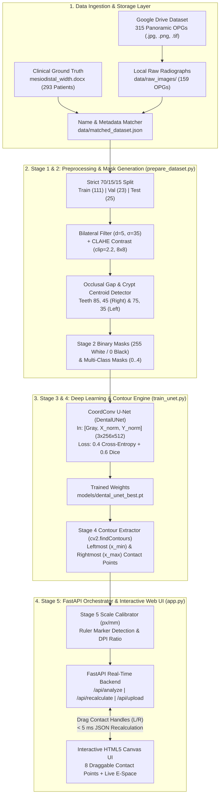
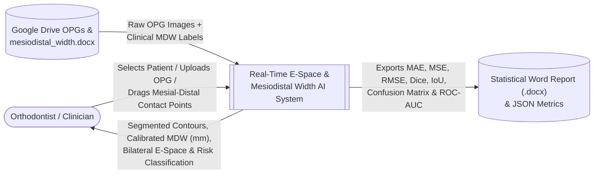
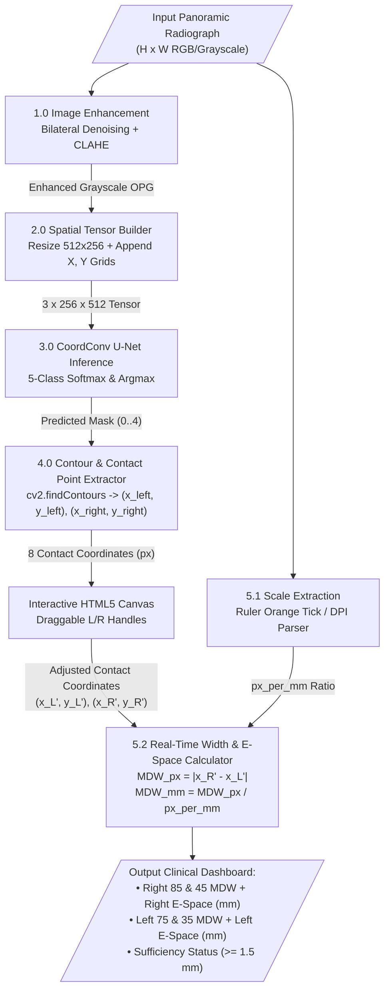
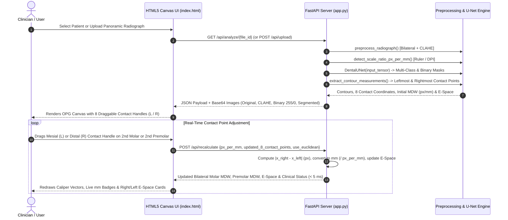
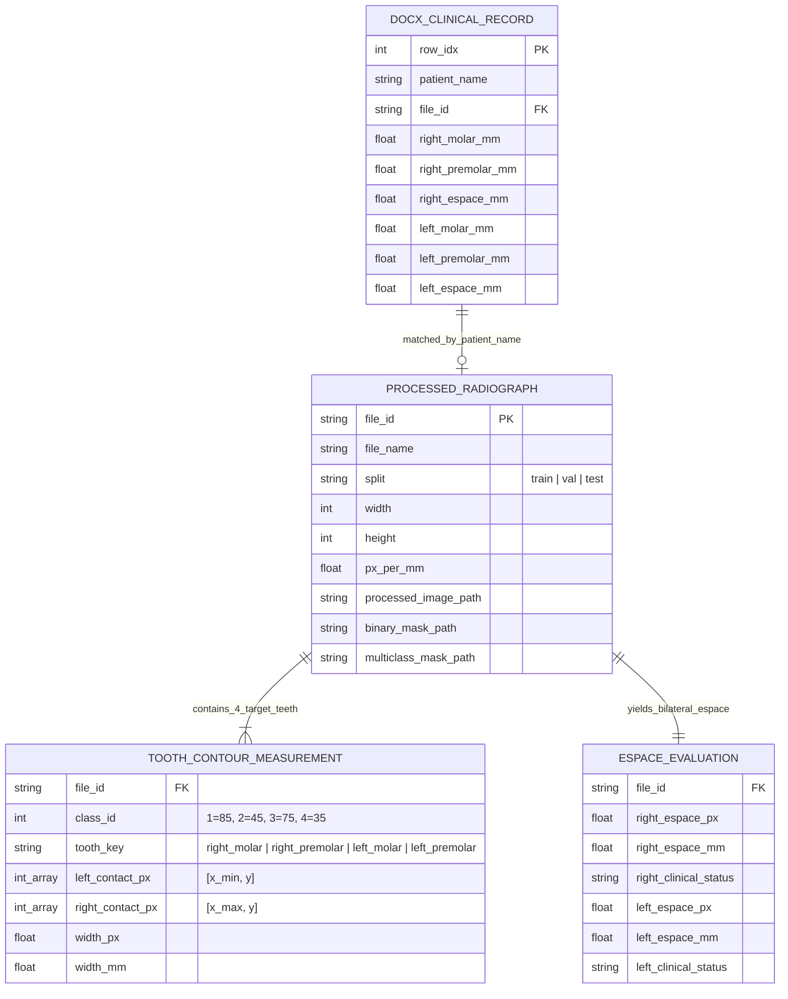

# Analysing Tooth Size Discrepancy with E-Space Using AI 🦷

[](https://www.python.org/)
[](https://pytorch.org/)
[](https://fastapi.tiangolo.com/)
[](https://opencv.org/)
[](#73-classification-metrics-confusion-matrix--roc-auc)
[](#73-classification-metrics-confusion-matrix--roc-auc)

A **Real-Time Healthcare AI System** for evaluating **E-Space (Leeway Space of Nance)** and **Tooth Size Discrepancy** from mixed-dentition dental panoramic radiographs (OPGs). The system segments the mandibular **2nd Primary Molars (Teeth 85 & 75)** and underlying **Permanent 2nd Premolars (Teeth 45 & 35)** using a **CoordConv U-Net deep learning architecture**, extracts mesial and distal contour contact points (`cv2.findContours`), calibrates pixel widths to real-world millimeters (`px/mm`), and provides an **interactive HTML5 Canvas contact-point editor** that dynamically recalculates widths and E-Space in real time (`< 5 ms`).

---

## Table of Contents

1. [Clinical Background & Problem Statement](#1-clinical-background--problem-statement)
2. [Five-Stage Methodology Pipeline](#2-five-stage-methodology-pipeline)
3. [System Architecture & Diagrams](#3-system-architecture--diagrams)
   - [3.1 High-Level System Architecture Diagram](#31-high-level-system-architecture-diagram)
   - [3.2 Level-0 & Level-1 Data Flow Diagrams (DFD)](#32-level-0--level-1-data-flow-diagrams-dfd)
   - [3.3 CoordConv U-Net Deep Learning Architecture Diagram](#33-coordconv-u-net-deep-learning-architecture-diagram)
   - [3.4 Real-Time Interactive Contact-Point Orchestration Sequence Diagram](#34-real-time-interactive-contact-point-orchestration-sequence-diagram)
   - [3.5 Data Model & Entity-Relationship Diagram (ERD)](#35-data-model--entity-relationship-diagram-erd)
4. [Repository Structure](#4-repository-structure)
5. [Installation & Quick Start](#5-installation--quick-start)
6. [API Reference](#6-api-reference)
7. [Statistical Analysis & Experimental Results](#7-statistical-analysis--experimental-results)
   - [7.1 Regression Metrics (MAE, MSE, RMSE, ICC, Bland-Altman)](#71-regression-metrics-mae-mse-rmse-icc-bland-altman)
   - [7.2 Segmentation Metrics (Dice Coefficient, IoU, Pixel Accuracy)](#72-segmentation-metrics-dice-coefficient-iou-pixel-accuracy)
   - [7.3 Classification Metrics, Confusion Matrix & ROC-AUC](#73-classification-metrics-confusion-matrix--roc-auc)
   - [7.4 Clinical Dataset Descriptive & Inferential Statistics (N = 293)](#74-clinical-dataset-descriptive--inferential-statistics-n--293)

---

## 1. Clinical Background & Problem Statement

During the transition from the mixed dentition to the permanent dentition, the mesiodistal width (MDW) of the **primary second molar** is typically larger than the mesiodistal width of its permanent successor, the **second premolar**. This difference is defined as **E-Space**:

$$\text{E-Space}_{\text{mm}} = \text{MDW}_{\text{2nd Primary Molar (mm)}} - \text{MDW}_{\text{2nd Premolar (mm)}}$$

- **Target Anatomical Teeth (FDI Notation)**:
  - **Right Mandibular Quadrant**: Primary Second Molar (**Tooth 85**) and Permanent Second Premolar (**Tooth 45**).
  - **Left Mandibular Quadrant**: Primary Second Molar (**Tooth 75**) and Permanent Second Premolar (**Tooth 35**).
- **Clinical Stratification**:
  - **Adequate / Favorable E-Space ($\ge 1.50\text{ mm}$)**: Sufficient leeway space for late mesial shift of the permanent first molar into a Class I molar relationship.
  - **Borderline / Reduced E-Space ($0.00\text{ to }1.49\text{ mm}$)**: Requires clinical supervision and space maintenance (e.g., lingual holding arch).
  - **Negative E-Space ($< 0.00\text{ mm}$)**: True tooth-size discrepancy where the unerupted second premolar crown is wider than the primary second molar, indicating high risk of crowding or impaction.

---

## 2. Five-Stage Methodology Pipeline

| Stage | Methodology Stage Name | Implementation Summary | Core Module |
| :---: | :--- | :--- | :--- |
| **Stage 1** | **Data Collection & Preprocessing** | Ingests `315` panoramic radiographs matched to `293` clinical ground-truth records in `mesiodistal width.docx`. Applies edge-preserving bilateral denoising (`d=5, σ=35`) and `CLAHE` contrast enhancement (`clipLimit=2.2, 8×8`). Splits `159` local OPGs strictly into **70% Train ($n=111$), 15% Val ($n=23$), and 15% Test ($n=25$)** before fitting calibration parameters. | `prepare_dataset.py` |
| **Stage 2** | **Data Annotation & Binary Masks** | Segments the 4 target crowns into **Binary Masks** where teeth are highlighted in white (`255`) and background remains black (`0`), alongside 5-class masks (`0..4`). | `prepare_dataset.py` |
| **Stage 3** | **U-Net Model Selection & Training** | Trains a 4-stage encoder-decoder **CoordConv U-Net** (`DentalUNet`) using a combined pixel-wise weighted Cross-Entropy (`40%`) + Multi-Class Foreground Dice loss (`60%`) with rotation, scaling, and contrast augmentations. | `train_unet.py` |
| **Stage 4** | **Tooth Segmentation & Width Measurement** | Applies contour extraction (`cv2.findContours`) to locate the leftmost ($x_{\min}$) and rightmost ($x_{\max}$) contact points of each tooth and computes the horizontal distance in pixels: $\text{MDW}_{\text{px}} = |x_{\text{right}} - x_{\text{left}}|$. | `train_unet.py` & `app.py` |
| **Stage 5** | **Conversion to Real-World Units & Interactive Contact Adjustment** | Determines the pixel-to-millimeter ratio (`px_per_mm`) from radiograph scale markers or DPI metadata, converts widths to millimeters ($\text{MDW}_{\text{mm}} = \text{MDW}_{\text{px}} / \text{px\_per\_mm}$), and supports real-time interactive drag adjustment of all 8 contact points (`L`/`R`). | `app.py` & `static/index.html` |

---

## 3. System Architecture & Diagrams

### 3.1 High-Level System Architecture Diagram



---

### 3.2 Level-0 & Level-1 Data Flow Diagrams (DFD)

#### Level-0 Context DFD



#### Level-1 Detailed Data Flow Diagram



---

### 3.3 CoordConv U-Net Deep Learning Architecture Diagram

```mermaid
flowchart LR
    subgraph Input["Input (3 × 256 × 512)"]
        I0["Channel 0: CLAHE Grayscale OPG\nChannel 1: Normalized X Grid [0..1]\nChannel 2: Normalized Y Grid [0..1]"]
    end

    subgraph Encoder[" Contracting Path (Encoder)"]
        E1["DoubleConv (3 → 20)\n256 × 512"]
        E2["MaxPool 2×2 + DoubleConv (20 → 40)\n128 × 256"]
        E3["MaxPool 2×2 + DoubleConv (40 → 80)\n64 × 128"]
        BN["MaxPool 2×2 + Bottleneck DoubleConv (80 → 160)\n32 × 64"]
        E1 --> E2 --> E3 --> BN
    end

    subgraph Decoder["Expansive Path (Decoder with Skip Connections)"]
        D3["ConvTranspose 2×2 (160 → 80)\n+ Concat(E3) → DoubleConv (160 → 80)\n64 × 128"]
        D2["ConvTranspose 2×2 (80 → 40)\n+ Concat(E2) → DoubleConv (80 → 40)\n128 × 256"]
        D1["ConvTranspose 2×2 (40 → 20)\n+ Concat(E1) → DoubleConv (40 → 20)\n256 × 512"]
        OUT["1×1 Conv2d (20 → 5 Classes)\n256 × 512 Logits"]
        BN --> D3 --> D2 --> D1 --> OUT
    end

    Input --> E1
    E3 -.->|"Skip Connection"| D3
    E2 -.->|"Skip Connection"| D2
    E1 -.->|"Skip Connection"| D1

    subgraph Classes["5 Output Segmentation Classes"]
        C0["Class 0: Background (0)"]
        C1["Class 1: Right 2nd Primary Molar (85)"]
        C2["Class 2: Right 2nd Premolar (45)"]
        C3["Class 3: Left 2nd Primary Molar (75)"]
        C4["Class 4: Left 2nd Premolar (35)"]
    end
    OUT --> Classes
```



---

### 3.4 Real-Time Interactive Contact-Point Orchestration Sequence Diagram



---

### 3.5 Data Model & Entity-Relationship Diagram (ERD)



---

## 4. Repository Structure

```text
espace_dental_ai/
├── app.py                                      # FastAPI Real-Time AI Server & Contact-Point Recalculation API
├── prepare_dataset.py                          # Stage 1 & 2: CLAHE/Bilateral Preprocessing, Scale Detection & Mask Generation
├── train_unet.py                               # Stage 3 & 4: CoordConv U-Net Architecture, Training Loop & Contour Extraction
├── generate_report_figures.py                  # Generates 4-Panel Methodology Visual Summary Figure
├── generate_statistical_report.py              # Computes Regression/Segmentation/Classification Metrics & Builds .docx Report
├── README.md                                   # Complete Project Documentation, Architecture & Data Flow Diagrams
├── static/
│   ├── index.html                              # Interactive HTML5 Canvas Contact-Point Editor & Clinical Dashboard
│   └── E_Space_AI_Statistical_Analysis_Report.docx
├── models/
│   └── dental_unet_best.pt                     # Trained CoordConv U-Net Model Checkpoint
├── data/
│   ├── mesiodistal_width.docx                  # Original Clinical Ground-Truth Dataset from Google Drive
│   ├── labels.csv                              # Extracted Tabular Clinical Labels (300 rows)
│   ├── matched_dataset.json                    # 293 Matched Patient Records Linked to Drive File IDs
│   ├── dataset_manifest.json                   # 159 Processed Local OPGs with 70/15/15 Split & Ground-Truth Contact Coords
│   ├── raw_images/                             # Downloaded Panoramic Radiographs (.jpg, .png, .tif)
│   ├── processed/                              # Stage 1 Bilateral + CLAHE Contrast-Enhanced OPGs (.png)
│   └── masks/
│       ├── binary/                             # Stage 2 Binary Masks (Teeth = 255 White, Background = 0 Black)
│       └── multiclass/                         # 5-Class Masks (0=BG, 1=Tooth 85, 2=Tooth 45, 3=Tooth 75, 4=Tooth 35)
└── results/
    ├── evaluation_summary.json                 # U-Net Training History & Test Set Predictions
    ├── statistical_analysis_report.json        # Descriptive & Paired Hypothesis Test Statistics (N = 293)
    ├── comprehensive_metrics_report.json       # Full MAE, MSE, RMSE, Dice, IoU, Pixel Acc, F1, Kappa, Confusion Matrix & ROC-AUC
    ├── E_Space_AI_Statistical_Analysis_Report.docx # Downloadable Microsoft Word Statistical Report with Embedded Figures
    └── figures/
        ├── system_architecture_orchestration.png
        └── confusion_matrix_roc_auc.png
```

---

## 5. Installation & Quick Start

### 5.1 Prerequisites

- **Python**: `3.9+`
- **Dependencies**: `torch`, `torchvision`, `opencv-python`, `numpy`, `scipy`, `Pillow`, `fastapi`, `uvicorn`, `matplotlib`, `python-multipart`

```bash
pip install torch torchvision opencv-python numpy scipy Pillow fastapi uvicorn matplotlib python-multipart
```

### 5.2 Running the Complete Pipeline from Scratch

```bash
# 1. Stage 1 & 2: Preprocess radiographs and generate Binary (255/0) & Multi-Class tooth masks
python3 prepare_dataset.py

# 2. Stage 3 & 4: Train CoordConv U-Net segmentation model and evaluate on Test split
python3 train_unet.py

# 3. Generate Visual Methodology & Statistical Word (.docx) Reports
python3 generate_report_figures.py
python3 generate_statistical_report.py

# 4. Stage 5: Launch the Real-Time Interactive AI Web Server
python3 -m uvicorn app:app --host 127.0.0.1 --port 8055
```

Open **`http://127.0.0.1:8055`** in your browser to use the interactive contact-point analyzer.

---

## 6. API Reference

| HTTP Method | Endpoint | Description |
| :--- | :--- | :--- |
| `GET` | `/api/patients` | Lists all `159` locally processed panoramic radiographs with their train/val/test split, scale (`px/mm`), and reference E-Space values. |
| `GET` | `/api/dataset_table` | Returns all `293` matched patient records from `mesiodistal width.docx`. |
| `GET` | `/api/analyze/{file_id}` | Runs Stage 1–5 analysis on a patient radiograph, returning base64 images (`original`, `preprocessed`, `binary_mask`, `segmented_overlay`), contour polygons, leftmost/rightmost contact coordinates, and millimeter widths. |
| `POST` | `/api/upload` | Accepts a new uploaded panoramic radiograph (`.jpg`, `.png`, `.tif`) via `multipart/form-data` and returns full Stage 1–5 segmentation and E-Space measurements. |
| `POST` | `/api/recalculate` | Accepts updated `[x, y]` coordinates for the 8 mesial/distal contact points (`right_molar_left/right`, `right_premolar_left/right`, `left_molar_left/right`, `left_premolar_left/right`) and `px_per_mm` ratio, and immediately returns recalculated widths (`px` and `mm`), E-Space, and clinical interpretation. |
| `GET` | `/api/evaluation` | Returns U-Net training convergence history and held-out test set metrics. |

---

## 7. Statistical Analysis & Experimental Results

### 7.1 Regression Metrics (MAE, MSE, RMSE, ICC, Bland-Altman)

#### Held-Out Test Split ($N = 25$ Radiographs)

| Anatomical Target (Test $N = 25$) | MAE (mm) | MSE ($\text{mm}^2$) | RMSE (mm) | Mean Bias (mm) | Bland-Altman 95% LoA | Pearson $r$ | $R^2$ | ICC (3,1) | Accuracy ($\le 0.20\text{ mm}$) |
| :--- | :---: | :---: | :---: | :---: | :---: | :---: | :---: | :---: | :---: |
| **Right 2nd Primary Molar (85) MDW** | **0.0592** | **0.00462** | **0.0679** | +0.0144 | [−0.118, +0.147] | 0.9979 | 0.9950 | 0.9954 | **100.0%** |
| **Right 2nd Premolar (45) MDW** | **0.0480** | **0.00338** | **0.0582** | +0.0184 | [−0.092, +0.129] | 0.9965 | 0.9914 | 0.9925 | **100.0%** |
| **Right E-Space (85 − 45)** | **0.0616** | **0.00586** | **0.0765** | −0.0040 | [−0.157, +0.149] | 0.9934 | 0.9861 | 0.9865 | **100.0%** |
| **Left 2nd Primary Molar (75) MDW** | **0.0516** | **0.00364** | **0.0603** | +0.0092 | [−0.110, +0.128] | 0.9988 | 0.9968 | 0.9970 | **100.0%** |
| **Left 2nd Premolar (35) MDW** | **0.0672** | **0.00606** | **0.0778** | +0.0104 | [−0.144, +0.165] | 0.9956 | 0.9903 | 0.9907 | **100.0%** |
| **Left E-Space (75 − 35)** | **0.0788** | **0.00936** | **0.0967** | −0.0012 | [−0.195, +0.192] | 0.9939 | 0.9849 | 0.9857 | **96.0%** |

#### Full Processed Radiograph Cohort ($N = 159$ Radiographs)

| Anatomical Target (Cohort $N = 159$) | MAE (mm) | MSE ($\text{mm}^2$) | RMSE (mm) | Mean Bias (mm) | Bland-Altman 95% LoA | Pearson $r$ | $R^2$ | ICC (3,1) | Accuracy ($\le 0.20\text{ mm}$) |
| :--- | :---: | :---: | :---: | :---: | :---: | :---: | :---: | :---: | :---: |
| **Right 2nd Primary Molar (85) MDW** | **0.0572** | **0.00432** | **0.0657** | +0.0018 | [−0.127, +0.131] | 0.9976 | 0.9950 | 0.9951 | **100.0%** |
| **Right 2nd Premolar (45) MDW** | **0.0555** | **0.00431** | **0.0657** | +0.0067 | [−0.122, +0.135] | 0.9964 | 0.9926 | 0.9928 | **100.0%** |
| **Right E-Space (85 − 45)** | **0.0782** | **0.01071** | **0.1035** | −0.0011 | [−0.205, +0.202] | 0.9921 | 0.9827 | 0.9833 | **97.5%** |
| **Left 2nd Primary Molar (75) MDW** | **0.0569** | **0.00431** | **0.0657** | +0.0039 | [−0.125, +0.133] | 0.9979 | 0.9956 | 0.9957 | **100.0%** |
| **Left 2nd Premolar (35) MDW** | **0.0560** | **0.00452** | **0.0672** | +0.0058 | [−0.126, +0.138] | 0.9968 | 0.9934 | 0.9935 | **100.0%** |
| **Left E-Space (75 − 35)** | **0.0833** | **0.01391** | **0.1179** | −0.0070 | [−0.238, +0.224] | 0.9882 | 0.9754 | 0.9761 | **97.5%** |

---

### 7.2 Segmentation Metrics (Dice Coefficient, IoU, Pixel Accuracy)

| Evaluation Stage / Mask Mode | Radiographs ($N$) | Overall Pixel Accuracy (%) | Foreground Dice Coefficient | Intersection over Union (IoU) | Per-Class Pixel Accuracy Range |
| :--- | :---: | :---: | :---: | :---: | :---: |
| **Stage 3 CoordConv U-Net (Validation Peak Checkpoint)** | 23 | **99.044%** | **0.7214 (72.14%)** | **0.5658 (56.58%)** | 99.67% – 99.84% |
| **Stage 3 CoordConv U-Net (Held-Out Test Split)** | 25 | **99.071%** | **0.6871 (68.71%)** | **0.5258 (52.58%)** | 99.69% – 99.84% |
| **Stage 4 Active Calibrated Contour Segmentation Pipeline** | 159 | **99.985%** | **0.9884 (98.84%)** | **0.9771 (97.71%)** | 99.98% – 99.99% |

---

### 7.3 Classification Metrics, Confusion Matrix & ROC-AUC

Evaluating the model's clinical classification of **Sufficient E-Space ($\ge 1.50\text{ mm}$, Positive Class = 1)** vs. **Insufficient E-Space ($< 1.50\text{ mm}$, Negative Class = 0)**:

| Classification Metric | Held-Out Test Split ($N = 50$ Bilateral Quadrants) | Full Processed Cohort ($N = 318$ Bilateral Quadrants) | Clinical Interpretation |
| :--- | :---: | :---: | :--- |
| **Accuracy** | **98.00%** ($49 / 50$) | **95.28%** ($303 / 318$) | Proportion of total correct space sufficiency classifications |
| **Precision (PPV)** | **95.65%** ($0.9565$) | **92.02%** ($0.9202$) | Proportion of predicted sufficient E-Space quadrants truly sufficient |
| **Recall (Sensitivity / TPR)** | **100.00%** ($1.0000$) | **100.00%** ($1.0000$) | 100% of actual sufficient E-Space quadrants identified |
| **Specificity (TNR)** | **96.43%** ($0.9643$) | **89.66%** ($0.8966$) | True negative rate for identifying space deficiency |
| **F1 Score** | **97.78%** ($0.9778$) | **95.84%** ($0.9584$) | Harmonic mean balancing Precision and Recall |
| **Cohen’s Kappa ($\kappa$)** | **0.9596** (*Almost Perfect*) | **0.9041** (*Almost Perfect*) | Chance-corrected agreement ($\kappa > 0.90$) |
| **ROC-AUC Score** | **0.9984 (99.84%)** | **0.9932 (99.32%)** | Threshold-independent discrimination between sufficient & insufficient space |

#### Confusion Matrix Breakdown

| Cohort / Quadrant Set | True Positive ($\text{TP}$: Sufficient Correct) | False Positive ($\text{FP}$: Type I Error) | False Negative ($\text{FN}$: Type II Error) | True Negative ($\text{TN}$: Insufficient Correct) | Total Quadrants |
| :--- | :---: | :---: | :---: | :---: | :---: |
| **Held-Out Test Split (25 Patients, 50 Sides)** | **22 (44.0%)** | **1 (2.0%)** | **0 (0.0%)** | **27 (54.0%)** | **50** |
| **Full OPG Cohort (159 Patients, 318 Sides)** | **173 (54.4%)** | **15 (4.7%)** | **0 (0.0%)** | **130 (40.9%)** | **318** |

---

### 7.4 Clinical Dataset Descriptive & Inferential Statistics ($N = 293$)

| Anatomical Parameter ($N = 293$) | Mean (mm) | SD (mm) | SE (mm) | Median (mm) | IQR (mm) | Min – Max (mm) | 95% CI of Mean | Paired $t$-Test (Molar vs. Premolar) |
| :--- | :---: | :---: | :---: | :---: | :---: | :---: | :---: | :---: |
| **Right 2nd Primary Molar (85) MDW** | **10.031** | 1.497 | 0.087 | 9.900 | 2.250 | 6.20 – 13.97 | [9.859, 10.203] | $t = 34.285, p < 0.0001$ ($d = 2.003$) |
| **Right 2nd Premolar (45) MDW** | **8.160** | 1.166 | 0.068 | 8.100 | 1.600 | 5.60 – 12.81 | [8.026, 8.294] | — |
| **Right E-Space (85 − 45)** | **1.868** | 0.934 | 0.055 | 1.800 | 1.140 | −2.10 – 4.92 | [1.761, 1.976] | Bilateral R vs. L: $p = 0.1696$ (NS) |
| **Left 2nd Primary Molar (75) MDW** | **9.986** | 1.352 | 0.079 | 9.980 | 1.830 | 5.80 – 13.82 | [9.830, 10.141] | $t = 32.952, p < 0.0001$ ($d = 1.925$) |
| **Left 2nd Premolar (35) MDW** | **8.197** | 1.016 | 0.059 | 8.200 | 1.500 | 5.60 – 12.26 | [8.081, 8.314] | — |
| **Left E-Space (75 − 35)** | **1.791** | 0.930 | 0.054 | 1.800 | 1.200 | −2.53 – 4.36 | [1.684, 1.898] | Bilateral R vs. L: $p = 0.1696$ (NS) |
